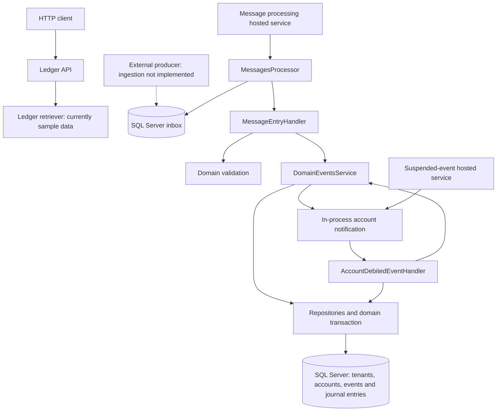

# High-level architecture

BoovatechInterview is a .NET 8, multi-tenant ledger prototype for tracking money transfers between accounts. It is organized as a layered application with an ASP.NET Core host, background message processing, domain rules, and Entity Framework Core persistence backed by SQL Server.

The design combines asynchronous transfer processing with a synchronous ledger query API. The repository contains the main building blocks, but integration and some implementations are incomplete; the flow below describes the intended architecture reflected in those components.

## Components

| Project | Responsibility |
| --- | --- |
| `Boovatech.Web` | Application entry point, HTTP controllers, Swagger in development, and registration of background services. Exposes `GET /api/Ledger`. |
| `Domain` | Tenants, accounts, transfer events, journal entries, validation rules, transfer processing, suspended-event handling, and repository/transaction contracts. |
| `Eventing` | Inbox polling and message handling, repository implementations, EF Core mappings, transaction management, and in-process notifications for suspended transfers. |
| `Infrastructure` | Hosted-service adapters that start the message processor and suspended-event recovery work inside the web host. |

Project references follow `Boovatech.Web → Infrastructure → Eventing → Domain`. Domain behavior depends on repository and transaction interfaces whose implementations live in Eventing. Some namespaces differ from their containing project names.

## Transfer processing

1. A transfer arrives as a JSON payload in the database inbox. The repository does not currently provide an external ingestion endpoint or producer integration.
2. `MessagesProcessor` polls available entries and attempts to claim each entry through `InboxMessagesStore`. A time-limited lease and SQL Server rowversion coordinate competing workers.
3. `MessageEntryHandler` deserializes the payload and validates the timestamp, non-negative amount, event kind, tenant, accounts, and permitted account-type direction.
4. The handler opens a domain transaction and attempts to register the event, rejecting duplicates. `EventsRepository` checks the event identifier and tenant using `UPDLOCK, HOLDLOCK`, then stages the insert in the same transaction. These hints request update and serializable locking semantics; actual lock granularity remains SQL Server's decision.
5. `DomainEventsService` locks the source account and checks its balance. A physical account with insufficient funds causes the event to be suspended. Otherwise, the destination account is locked, balances are adjusted, and two signed journal entries record the transfer.
6. `EventsRepository.MarkEventAsAsync` stages the appropriate suspended or processed timestamp. The handler awaits `CommitAsync()`, which saves tracked changes and commits the database transaction. The intended transaction boundary covers event registration, event status, account balances, and journal entries. Inbox completion is a separate database operation after handling.
7. The processor acknowledges completed handling or records a rejection. Unexpected exceptions leave the entry available for another attempt after its lease expires, while attempts remain.

The configured default is one initial attempt plus three retries. Exhausted entries remain in the inbox for inspection. This provides at-least-once delivery, so safe duplicate handling is necessary because a worker can fail after committing business changes but before acknowledging its inbox entry.

## Domain model and storage

- **Tenant:** identifies the owner of a set of accounts.
- **Account:** stores an account code, tenant, account type, and current integer balance. Account codes are unique within a tenant.
- **Domain event:** describes a transfer using an event identifier, tenant, kind, source, destination, amount, and occurrence/processing timestamps.
- **Account journal entry:** records a signed balance movement associated with an account and event. Each successful transfer stages a negative source entry and a positive destination entry.
- **Inbox message:** stores the incoming JSON, claim attempts, lease expiry, rowversion token, and processing outcome.

Validation currently permits the account-type chain `Bank → Vault → Truck → Atm → Clients`. Tenant and account catalog reads use process-wide caches with no expiry, so catalog changes require a process restart to be observed through those reads.

EF Core configurations are separated from entities under `Eventing/Data/EntityConfiguration`. Repositories use LINQ for ordinary data access and SQL Server queries and locking hints for selected concurrency-sensitive operations. Balances are maintained directly alongside a journal; historical ledger reconstruction is not implemented.

## Suspended-transfer recovery

After applying a transfer, the domain service publishes an account notification for the receiving account. Although named `AccountDebitedEvent`, this notification is used to reconsider outgoing transfers whose source account has received funds.

`SuspendedEventPublisher` dispatches the notification through an in-process, fire-and-forget task with its own dependency-injection scope. `AccountDebitedEventHandler` selects a candidate, opens a domain transaction, and reloads the stored event through `EventsRepository.FindAndLockAsync`. This query uses `ROWLOCK, UPDLOCK, HOLDLOCK` to request a row-level update lock with serializable semantics while the transaction remains active. The handler invokes the transfer service again and, on success, marks the event as processed before committing.

Candidate selection is separate from transactional locking. Both repository candidate queries select the earliest eligible unprocessed event per source account, ordered by occurrence time and event identifier. Eligibility currently requires the account balance to be strictly greater than the transfer amount; the queries do not explicitly require a suspended timestamp. The account-specific query restricts the search to one account and tenant.

`SuspendedEventsPumper` scans candidates across accounts and emits account notifications. Its hosted service currently performs one scan at startup; it does not implement a recurring polling loop.

These notifications are not durable and are scheduled before the originating transaction commits. The current implementation therefore does not guarantee reliable recovery delivery or visibility of committed balances. Locking serializes access to a selected event, but the locked lookup does not recheck its processed timestamp, so a candidate selected earlier can become stale before it is locked.

## Ledger query API

`GET /api/Ledger` accepts a request containing `TillEvent` and returns account names and values. The current retriever returns fixed sample balances and ignores the requested event boundary. Database-backed ledger queries and historical balance reconstruction remain to be implemented.

## Current implementation boundaries

The solution should be treated as a prototype rather than a fully integrated executable system:

- Host registration starts the background services, but does not wire the full processing dependency graph or invoke `AddEventingData`. The ledger retriever is also not registered.
- Initial event status lookup queries the database before the staged event insert is saved, so the initial registration/status workflow still requires correction. Both initial handling and successful suspended-event replay use asynchronous transaction commits; successful replay marks the event as processed before committing.
- Duplicate checks use tenant plus event identifier, while the EF primary key is the event identifier alone; the intended identifier scope needs to be reconciled.
- Recovery queries and the locked lookup need consistent eligibility checks to prevent stale candidates from being applied again. The account-specific candidate query also contains a literal dollar sign before its account parameter, which needs correction.
- Database migrations and automatic schema provisioning are absent.

The description is based on source inspection. No runtime or build validation was performed for this documentation change.
